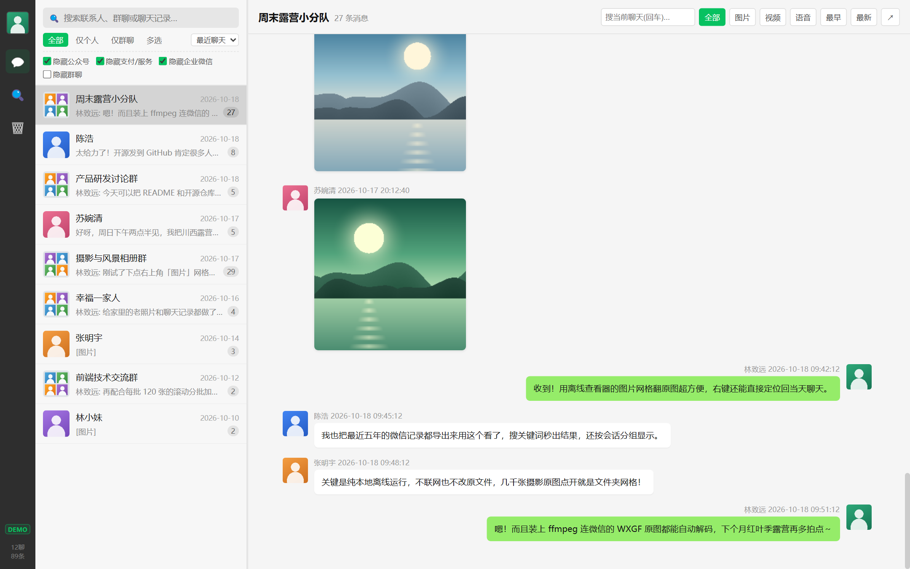
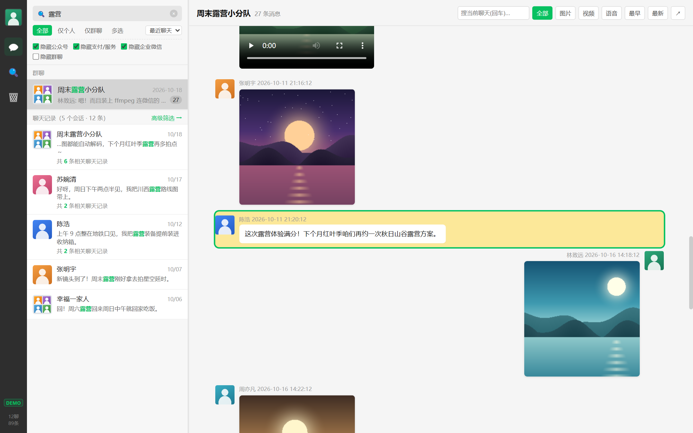
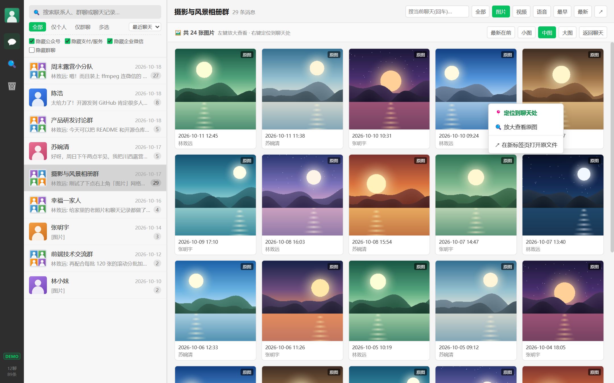

<div align="center">

# WeChat-HTML-Viewer

**高度还原 PC 微信界面的离线聊天记录查看器 · 专配 WechatExporter HTML 归档**

[](https://www.python.org/)
[-07C160)](viewer_server.py)
[](#-隐私与安全声明)
[](LICENSE)

[简体中文](README.md) · [English](README_EN.md)

</div>

---

使用 [WechatExporter](https://github.com/BlueMatthew/WechatExporter) 从 iPhone / iTunes 备份导出微信聊天记录为 HTML 后，原始页面虽然完整，但日常翻看体验仍有诸多不便：打开默认停在几年前的第一条消息、跨会话搜不到聊天正文、几千张图片只能上下竖排翻找、点开部分微信 `WXGF` 原图无法显示……

**WeChat-HTML-Viewer** 是一款**纯 Python 标准库、零第三方依赖、100% 本地离线**的桌面级 Web 查看器。无需安装任何数据库或复杂环境，直接读取你本地的 `WechatExporter` HTML 归档目录，为你呈现**几乎一比一还原 PC 微信**的三栏浏览、原生分组搜索与文件夹网格相册体验。

---

## ✨ 界面展示

> 以下展示图均由本仓库内置的 `--demo` **纯虚构中文演示数据**生成，不含任何真实个人隐私；你也可以运行 `python viewer_server.py --demo` 在本机 3 秒体验同款界面。

### 1. 高度还原 PC 微信三栏界面
默认按**最近聊天**排序，点开会话自动定位到**最新消息**（向上滚动翻阅历史），支持一键屏蔽公众号 / 支付服务 / 企业微信 / 群聊，专注于个人聊天记录。



### 2. 原生 PC 微信搜索逻辑（名称分区 + 仅搜正文 + 按会话聚合）
左侧搜索栏实时分区展示名称匹配的**联系人 / 群聊**与正文匹配的**聊天记录**；底层基于 SQLite FTS5，**严格只检索消息正文**（不被发言人昵称干扰），并按会话聚合展示 `共 N 条相关聊天记录`，点击即可展开明细并精准定位、高亮闪烁原消息。



### 3. 文件夹式图片/视频网格 + 右键「定位到聊天处」
点击顶部「图片」或「视频」，像资源管理器文件夹一样以规整 1:1 网格平铺浏览（支持小/中/大图缩放、最新/最早排序、每批 120 项自动分批懒加载，上万张图片也能流畅打开）。**右键任意图片或视频**，点击 **`📍 定位到聊天处`** 即可瞬间跳回该图片所在的聊天上下文！



### 4. 大图 / 视频灯箱预览 + 一键回跳原消息
左键单击任意图片或视频即可弹出高清灯箱预览（支持键盘 `←` / `→` 切换、`Esc` 关闭），顶部同样提供 **`📍 定位到聊天处`** 与打开原文件按钮；若本机安装了 `ffmpeg`，还可**自动透明解码微信私有 `WXGF` / `HEIC` 原图**。


---

## 🔍 对比原生 WechatExporter HTML

| 使用痛点 | 原生导出 HTML | WeChat-HTML-Viewer |
|---|---|---|
| 打开聊天后的位置 | 停在几年前最早第一条，手动往下翻半天 | **自动定位最新消息**，向上滚动翻看历史 |
| 跨会话全文搜索 | 只能逐个点开网页 `Ctrl+F` | **SQLite FTS5 毫秒级跨全库搜索**，原生微信分组展示 |
| 搜索精准度 | 无全局搜索 | **严格按正文匹配**，不受发言人备注名污染 |
| 浏览图片 / 视频 | 夹杂在气泡里上下竖排 | **文件夹式 1:1 网格平铺** + 分批懒加载 + 灯箱预览 |
| 看完图想看前后聊了啥 | 找不到上下文 | **右键图片/视频 → 一键「定位到聊天处」并高亮** |
| 公众号 / 广告群太杂乱 | 全部混在一起 | **一键隐藏公众号/支付/企微/群聊** + **右键/批量移入安全回收站** |
| 微信 `WXGF` / `HEIC` 原图裂图 | 浏览器无法识别直接白屏 | 可选配合 `ffmpeg` **透明解码并本地缓存**，不改动原图 |

---

## 📋 使用前提

本工具是**纯本地离线查看器**，不会直接读取或解密手机数据。使用前请确保满足以下两项前提：

1. **已导出 HTML 聊天记录**：请先使用开源工具 [**WechatExporter**](https://github.com/BlueMatthew/WechatExporter) 从 iPhone 的 iTunes 本地备份中将微信记录导出为 **HTML 格式**（导出后目录下会包含 `index.html` 及对应的账号文件夹）。
2. **Python 3.9 及以上环境**：仅使用 Python 标准库，**无需 `pip install` 任何第三方依赖**。
3. *(可选)* **安装 `ffmpeg`**：如果导出的 iPhone 微信原图包含微信私有 `WXGF`（HEVC）或 `HEIC` 格式导致原图点不开，将 `ffmpeg` 加入系统 `PATH` 后本工具会自动无损解码显示。

---

## 🚀 快速开始

### 1. 获取项目
```bash
git clone https://github.com/xiaoc1212/WeChat-HTML-Viewer.git
cd WeChat-HTML-Viewer
```

### 2. 三秒体验内置演示模式（无需准备聊天记录）
* **Windows**：直接双击 **`体验演示模式.bat`**
* **命令行（Windows / macOS / Linux）**：
  ```bash
  python viewer_server.py --demo
  ```

### 3. 打开你自己的 WechatExporter 导出目录
提供三种最顺手的打开方式（任选其一）：

* **方式 A（Windows 拖拽打开，最省心）**：
  直接把 `WechatExporter` 导出的根目录（包含 `index.html` 的那个文件夹）**用鼠标拖到 `启动查看器.bat` 图标上松开**即可自动建索引并打开浏览器。
* **方式 B（双击弹窗选择 / 同目录自动识别）**：
  直接双击 `启动查看器.bat`（macOS/Linux 运行 `./start.sh`）；若未在当前目录发现导出文件，会自动弹出文件夹选择框，且下次自动记住路径。
* **方式 C（命令行指定参数）**：
  ```bash
  # 指定 WechatExporter 导出根目录（支持单账号与多账号自动识别）
  python viewer_server.py --dir "D:\WeChat_HTML_Archive"

  # 强制重建全文检索索引（新增导出记录后使用）
  python viewer_server.py --dir "D:\WeChat_HTML_Archive" --rebuild

  # 指定端口 / 重新弹窗选目录 / 仅启动不自动开浏览器
  python viewer_server.py --port 18765 --pick --no-browser
  ```

> 首次打开包含几十万条消息的大型归档时，建立 SQLite FTS5 索引大约需要 **15～30 秒**，之后再次打开均为秒开。索引保存在工具自身的 `.viewer_cache/` 目录下，**不会污染或修改你的原导出文件夹**。

---

## 🛠️ 功能清单与快捷键

* **左侧会话栏**
  * 默认按 **最近聊天** 排序，支持切换「消息最多」「默认原序」
  * 顶部过滤胶囊：`全部` / `仅个人` / `仅群聊` / `多选`
  * 屏蔽复选框：`隐藏公众号` / `隐藏支付/服务` / `隐藏企业微信` / `隐藏群聊`（记忆上次勾选状态）
  * **原生微信式实时搜索**：上方分区展示名称匹配的 `联系人` 与 `群聊`，下方按会话聚合展示正文命中的 `聊天记录`（显示 `共 N 条相关聊天记录`，点击可下钻查看明细并逐条定位）
  * **右键单删 & 批量多选删除**：先移入左下角 `🗑️ 回收站`（不占列表、不进搜索、不删原文件，随时可恢复）；仅在回收站内主动点击「彻底删磁盘」并经过弹窗二次确认后，才会清理对应会话的磁盘文件
  * **多账号自动切换**：若 `WechatExporter` 导出了多个微信号，左下角会自动出现账号切换下拉框
* **右侧聊天与媒体区**
  * 顶部 `搜当前聊天`（回车逐条上下跳转定位高亮）
  * 顶部媒体切换：`全部` / `图片`（网格）/ `视频`（网格）/ `语音` / `最早` / `最新` / `↗ 原页面`
  * **图片/视频文件夹网格**：支持 `最新在前 / 最早在前`、`小图 / 中图 / 大图`、每批 120 项自动滚动加载
  * **右键图片或视频**（网格内、普通聊天内均可用）：弹出菜单一键 **`📍 定位到聊天处`**
* **常用快捷键**
  * `Ctrl + K`（macOS 为 `Cmd + K`）：打开高级全局全文搜索（支持按消息类型、日期区间、指定会话筛选）
  * 灯箱预览时：`←` / `→` 切换上一张/下一张，`Esc` 关闭预览

---

## 🔒 隐私与安全声明

* **100% 本机离线运行**：服务端严格仅监听 `127.0.0.1`（本机回环地址），**零外网请求、零数据上报、零统计埋点**。
* **默认只读保护原文件**：索引库与 `WXGF` 解码缓存均独立存放在 `.viewer_cache/` 中，绝不改写你的原始导出 HTML、图片、语音或视频（除非你在回收站中手动二次确认执行磁盘清理）。
* **严格路径隔离**：静态文件访问均经 `Path.resolve().relative_to()` 校验，防止越权路径遍历。

---

## ❓ 常见问题（FAQ）

**Q1：为什么点击某些高清大图打不开或显示裂图？**
> iPhone 新版微信保存的部分原图实际上是腾讯私有的 `WXGF`（HEVC 封装）或 `HEIC` 格式，尽管后缀名是 `.jpg`，普通浏览器无法直接解码。只要本机安装了 [`ffmpeg`](https://ffmpeg.org/) 并加入 `PATH`（Windows 也可直接放到 `C:\ffmpeg\bin\ffmpeg.exe`），本查看器会在后台自动识别文件头并透明转码为标准 JPEG 缓存，无需手动处理任何文件。

**Q2：为什么 1～2 个字的中文搜索和 3 个字以上速度不一样？**
> SQLite 内置的 `FTS5 trigram` 分词器对 3 字符及以上的关键词可走毫秒级倒排索引（50 万条记录约 5ms）；对 1～2 个字的短词，后端会自动无缝回退为精确的 `m.content LIKE` 全文扫描（50 万条约 140ms），既不漏查也绝不误匹配发言人名字。

**Q3：支持直接读取手机里的 `MM.sqlite` / `message_x.sqlite` 吗？**
> 不支持直接读取微信原生数据库。请先使用 [WechatExporter](https://github.com/BlueMatthew/WechatExporter) 将备份导出为标准 HTML 格式后再由本工具加载浏览。

---

## 🙏 致谢与开源协议

* 感谢 [BlueMatthew/WechatExporter](https://github.com/BlueMatthew/WechatExporter) 提供优秀的开源微信备份导出工具。
* 本项目采用 [MIT License](LICENSE) 开源，欢迎提交 Issue 与 Pull Request！
