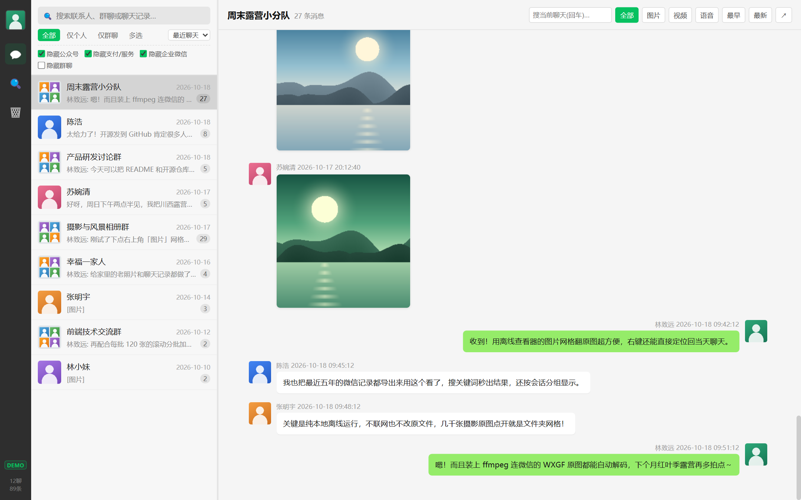
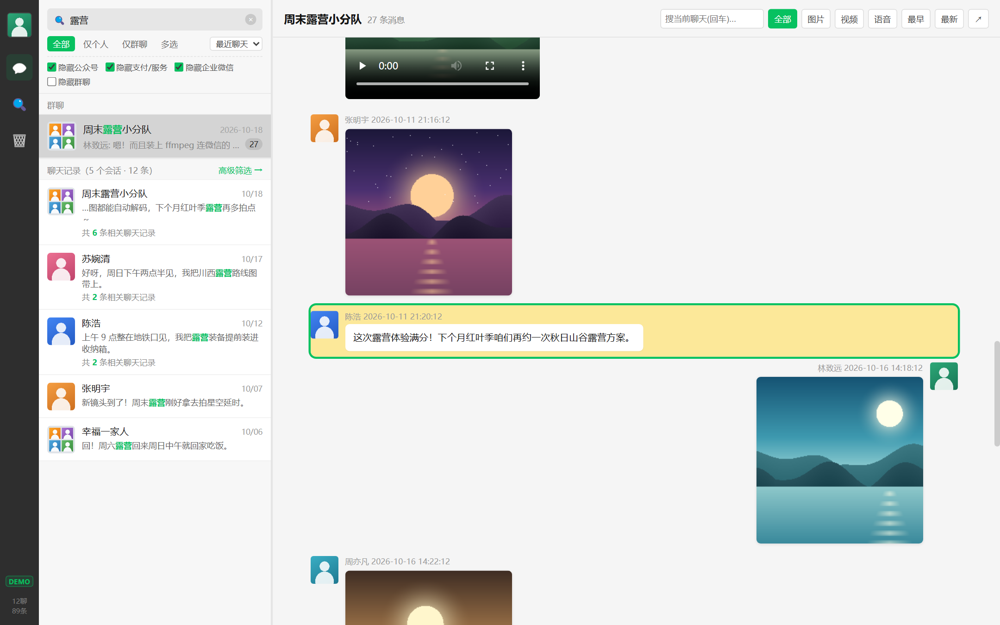
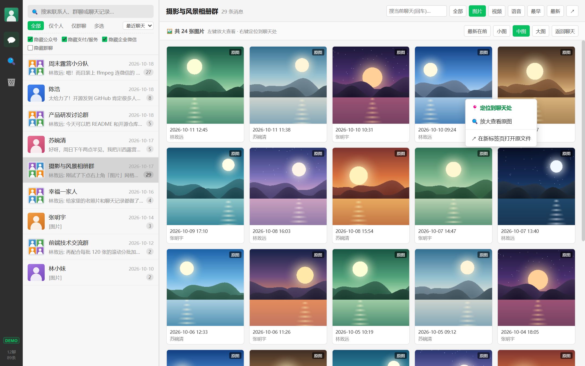
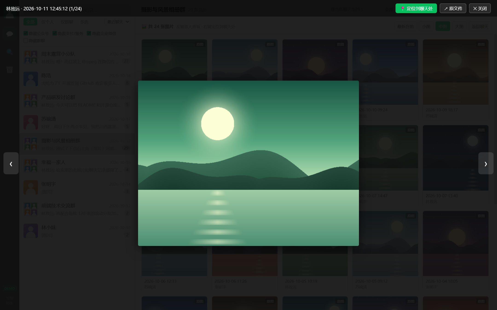

<div align="center">

# WeChat-HTML-Viewer

**A native PC-WeChat-style offline viewer for HTML chat archives exported by WechatExporter**

[](https://www.python.org/)
[-07C160)](viewer_server.py)
[](README.md)
[](LICENSE)

[简体中文](README.md) · [English](README_EN.md)

</div>

---

**WeChat-HTML-Viewer** turns static HTML folders exported by [WechatExporter](https://github.com/BlueMatthew/WechatExporter) into a fast, faithful, **100% local offline PC-WeChat-like desktop viewer** — written in **zero-dependency Python 3.9+ stdlib** and vanilla HTML/CSS/JS.

## ✨ Key Features

- **Authentic PC WeChat 3-Pane UI**: Sorted by recent chats by default; opens every conversation pinned to the **latest messages** (scroll up for history).
- **Native WeChat Search Experience**:
  - Top sections cleanly split name-matched **Contacts** and **Group Chats**.
  - Bottom **Chat History** section searches **message body only** via SQLite FTS5 (never polluted by sender nicknames), grouped by chat (`N related messages`) with green keyword highlighting, inline drill-down, and one-click jump-to-message flash highlight.
- **Folder-Style Media Grid + Right-Click "Locate in Chat"**:
  - Browse all photos or videos in a crisp 1:1 grid (Small / Medium / Large tiles, Newest / Oldest sorting, chunked lazy-loading for chats with thousands of photos).
  - **Right-click any photo or video** (in the grid OR inside normal chat bubbles) to immediately **Locate in Chat** with context highlight, or open the built-in Lightbox modal (`←` / `→` / `Esc`).
- **Declutter & Safe Trash**: One-click toggles to hide Official Accounts, WeChat Pay / Service Notifications, WeCom (`@openim`), and Groups. Right-click or batch multi-select chats to move them into a reversible Trash bin.
- **Transparent `WXGF` / `HEIC` Decoding**: When `ffmpeg` is available on the system, proprietary WeChat `WXGF` (HEVC) and `HEIC` images are decoded on-the-fly into a local cache without modifying any original archive files.
- **Built-in Zero-Privacy `--demo` Mode**: Try the complete interface in 3 seconds using 100% synthetic demo chats and procedural artwork.

## 🖼️ Screenshots (Generated from Synthetic `--demo` Data)

| Main Chat Interface | Native Grouped WeChat Search |
| :---: | :---: |
|  |  |

| Folder-Style Media Grid + Right-Click Locate | Lightbox Preview |
| :---: | :---: |
|  |  |

## 📋 Prerequisites

1. Export your WeChat iTunes backup to **HTML** using [WechatExporter](https://github.com/BlueMatthew/WechatExporter).
2. **Python 3.9+** (zero `pip` packages required).
3. *(Optional)* **`ffmpeg`** in `PATH` for automatic decoding of WeChat `WXGF` / `HEIC` original images.

## 🚀 Quick Start

```bash
# 1. Try the built-in synthetic demo immediately (zero personal data)
python viewer_server.py --demo

# 2. Open your own WechatExporter HTML output folder
python viewer_server.py --dir "/path/to/WeChat_HTML_Archive"

# 3. Rebuild full-text search index after updating your export
python viewer_server.py --dir "/path/to/WeChat_HTML_Archive" --rebuild
```

On Windows, you can also double-click `启动查看器.bat` (or drag & drop your `WechatExporter` folder directly onto `启动查看器.bat`), or double-click `体验演示模式.bat` for Demo mode.

## 🔒 Privacy

- Binds exclusively to `127.0.0.1`. No network calls, no telemetry, no cloud services.
- Keeps all search indexes and decoded image caches inside `.viewer_cache/` without modifying your original export directory.

## 📄 License

[MIT License](LICENSE)
